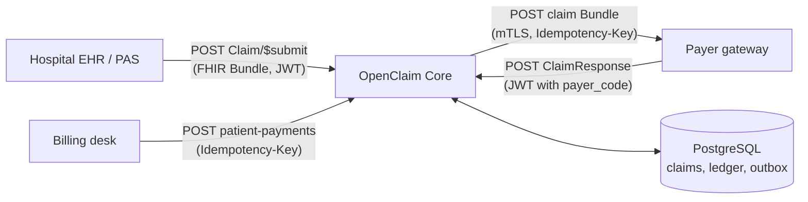
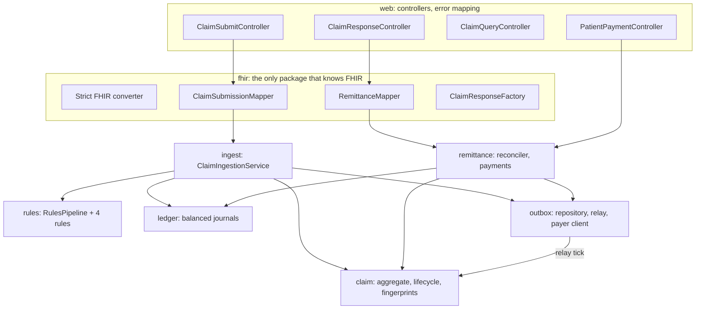
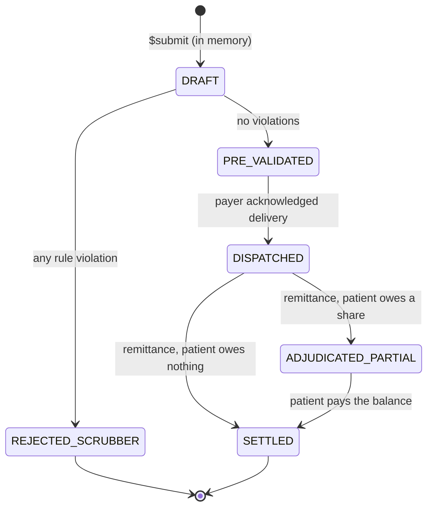
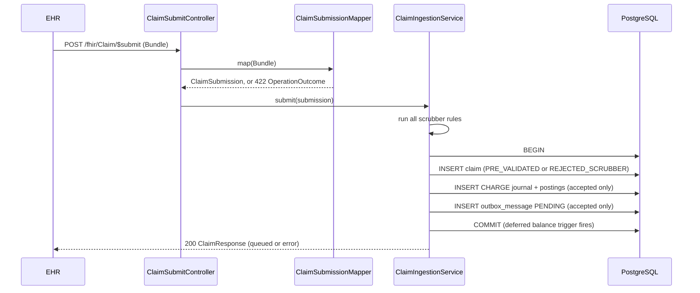
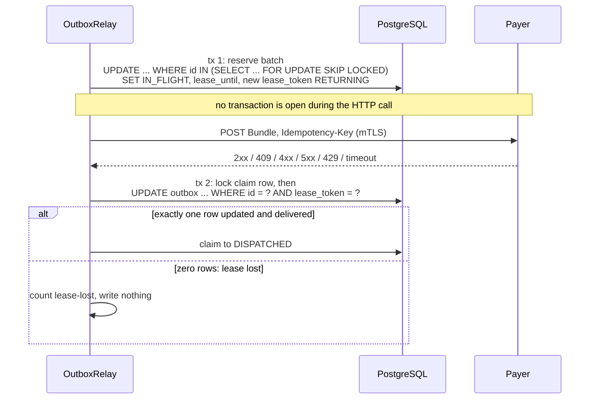
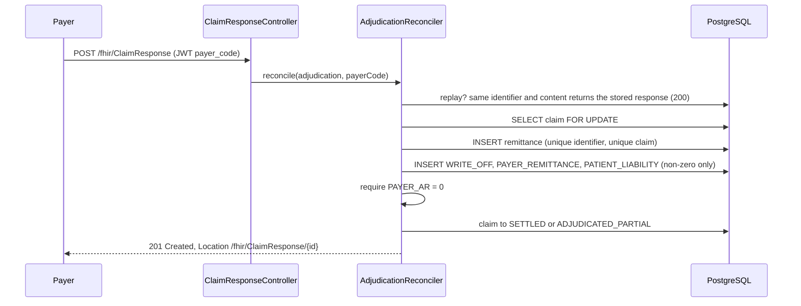
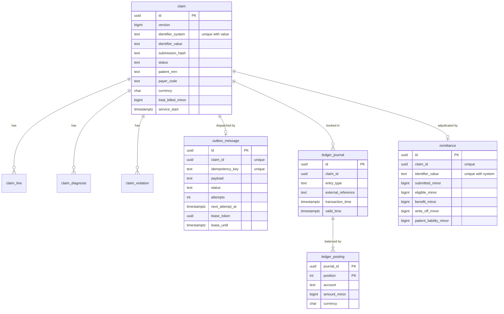

# OpenClaim Core


A healthcare **claims clearinghouse engine** built on **HL7 FHIR R5** and **Spring Boot 4**.

A hospital's EHR submits a claim as a FHIR Bundle. OpenClaim Core then:
1. checks the claim against billing rules;
2. records the charge in an append-only, double-entry ledger;
3. delivers accepted claims to the payer through a transactional outbox;
4. reconciles the payer's adjudication, and later the patient's payment, back into the ledger.

The code aims to show how the hard parts of an integration service are handled, rather than just the happy path:
- **No dual writes:** the database and the payer can't disagree about what was sent.
- **Exactly one booking** for every retried request.
- **Safe delivery across crashes:** leases and fencing tokens protect the outbox relay.
- **Accounting invariants enforced by the database itself.**
- **Tests that are proven to catch bugs:** each guard was removed and a test was watched fail.

The original brief is [`spec.md`](spec.md). It was revised after review to match what is built. The [design decisions](#design-decisions) section records where and why the implementation departs from the first draft.

## Contents

- [At a glance](#at-a-glance)
- [Quick start](#quick-start)
- [Walkthrough](#walkthrough)
- [Architecture](#architecture)
- [Claim lifecycle](#claim-lifecycle)
- [Ingest: `Claim/$submit`](#ingest-claimsubmit)
- [The scrubber](#the-scrubber)
- [Outbox relay](#outbox-relay)
- [Remittance and patient payments](#remittance-and-patient-payments)
- [Ledger](#ledger)
- [Data model](#data-model)
- [Concurrency](#concurrency)
- [Authentication](#authentication)
- [API reference](#api-reference)
- [FHIR R5 notes](#fhir-r5-notes)
- [Configuration](#configuration)
- [Operations](#operations)
- [Testing](#testing)
- [Project layout](#project-layout)
- [Tech stack](#tech-stack)
- [Design decisions](#design-decisions)
- [Non-goals](#non-goals)

## At a glance

| Concern | How it is handled |
|---|---|
| Duplicate submissions from the EHR | Unique `Claim.identifier` plus a content fingerprint: same content replays the stored answer, different content is a 409 |
| Claim stored but never sent (or sent but never stored) | Claim, charge and outbox row commit in one local transaction. The payer is called later by a relay. |
| Relay crashes or stalls mid-delivery | Time-limited lease plus a fencing token. A stale relay's writes match no row. The payer de-duplicates on `Idempotency-Key`. |
| Payer outages and throttling | Exponential backoff with jitter, honouring `Retry-After` up to a cap. Permanent 4xx errors park the message as `FAILED`. |
| Money correctness | Integer minor units, one configured currency, overflow-checked sums. Every journal must balance, **checked by a database trigger at commit**. |
| Audit | Ledger rows cannot be updated, deleted or truncated (triggers). Transaction time comes from the database clock; valid time is the date of care. |
| Payers seeing each other's claims | The payer identity comes from the token. Another payer's claim looks exactly like a missing one. |
| Patient data in logs | Logs identify claims only by internal UUID. Payer response bodies are never read or logged. |

## Quick start

Prerequisites: **JDK 25** and a running **Docker** daemon. [CONTRIBUTING.md](CONTRIBUTING.md) covers the environment traps.

```bash
./mvnw verify                                          # format check, unit + integration tests, coverage
scripts/dev-keys.sh                                    # once: local RSA key pair for dev tokens (git-ignored)
./mvnw spring-boot:run -Dspring-boot.run.profiles=dev  # starts PostgreSQL + a stand-in payer via compose.yaml
```

The `dev` profile uses `compose.yaml` to start PostgreSQL and a WireMock payer on `localhost:8089` that accepts every claim.

## Walkthrough

Each step was run against the `dev` profile; the amounts come from `samples/`.

```bash
EHR=$(scripts/dev-token.sh "claims:write claims:read")
PAYER=$(scripts/dev-token.sh "remittance:write" ACME-HEALTH)
BILLING=$(scripts/dev-token.sh "payments:write")

# 1. Submit a claim (spirometry 125.00 + consultation 80.50): ClaimResponse, outcome "queued"
curl -s -X POST 'localhost:8080/fhir/Claim/$submit' -H "Authorization: Bearer $EHR" \
     -H 'Content-Type: application/fhir+json' --data @samples/claim-bundle.json
CLAIM=<id from the response>

# 2. Moments later the relay has delivered it: status DISPATCHED, payer receivable 205.50
curl -s localhost:8080/api/claims/$CLAIM -H "Authorization: Bearer $EHR"
curl -s localhost:8089/__admin/requests            # what the payer received, including Idempotency-Key

# 3. The payer adjudicates: eligible 180.00, pays 150.00, patient owes 30.00 -> ADJUDICATED_PARTIAL
curl -s -X POST localhost:8080/fhir/ClaimResponse -H "Authorization: Bearer $PAYER" \
     -H 'Content-Type: application/fhir+json' --data @samples/claim-response-partial.json

# 4. The patient pays the 30.00 -> SETTLED; all ten postings sum to zero
curl -s -X POST localhost:8080/api/claims/$CLAIM/patient-payments -H "Authorization: Bearer $BILLING" \
     -H 'Content-Type: application/json' -H 'Idempotency-Key: till-0001' -d '{"amount": 30.00, "currency": "EUR"}'

# 5. A claim the scrubber rejects: outcome "error", one error per violation
curl -s -X POST 'localhost:8080/fhir/Claim/$submit' -H "Authorization: Bearer $EHR" \
     -H 'Content-Type: application/fhir+json' --data @samples/claim-bundle-invalid.json
```

Repeating any of these requests is safe. Submissions, remittances and payments are all idempotent.

## Architecture

### System context



### Components



| Package | Responsibility |
|---|---|
| `fhir` | Strict JSON converter, Bundle-to-canonical mapping, ClaimResponse building and reading. The only package besides `web` that may use HAPI types. |
| `claim` | Claim aggregate, lifecycle, the canonical `ClaimSubmission`, content fingerprints and dispatch keys. |
| `rules` | Scrubber pipeline and the four rules: pure functions over a fee schedule snapshot. |
| `ledger` | Balanced journals, balances, the `FinancialLedgerEntry` read model. |
| `ingest` | The `$submit` transaction. |
| `outbox` | Outbox storage, the relay, the payer HTTP client. |
| `remittance` | Adjudication reconciliation and patient payments. |
| `web` | Controllers; `OperationOutcome` and RFC 9457 problem-detail error mapping. |
| `config` | Typed, validated `openclaim.*` properties, security, clock. |

`ArchitectureTest` (ArchUnit) keeps these boundaries honest:
- no package cycles
- no HAPI types outside `fhir` and `web`
- no servlet or MVC types in the domain
- rules never touch the database
- postings are only built inside `ledger`
- `claim` and `ledger` depend on nothing else in the application

## Claim lifecycle



- **Exhaustive transitions:** `ClaimStatus.canTransitionTo` is an exhaustive `switch`. Adding a status without deciding its outgoing transitions is a compile error, and a 6×6 table test pins every allowed and forbidden pair.
- **`DRAFT` never reaches the database:** a claim is first stored already scrubbed.
- **`REJECTED_SCRUBBER` is terminal:** a corrected claim is resubmitted under a new `Claim.identifier`.
- **Write-offs alone don't make a claim partial:** a claim whose only reduction is a contractual write-off goes straight to `SETTLED`. `ADJUDICATED_PARTIAL` means the patient still owes something.

## Ingest: `Claim/$submit`



**No dual write.** Nothing talks to the payer during ingest, so a crash can't leave a claim that's billed but never queued, or queued but never recorded. The outbox's only write path, `OutboxRepository.enqueueDispatch`, refuses any claim that isn't `PRE_VALIDATED`.

**Re-transmission.** `claim(identifier_system, identifier_value)` is unique:
- **Where the replay runs:** PostgreSQL aborts a transaction on a unique violation, so after catching `DuplicateKeyException` the replay lookup runs in a fresh transaction, outside the failed one.
- **Replay or conflict:** the stored claim's **content fingerprint** decides. The same content replays the stored response; different content is a `409`.
- **Why the fingerprint uses the mapped model:** it is SHA-256 over the *mapped* submission, not the raw bytes, so JSON whitespace or key order doesn't cause false conflicts.
- **Concurrent duplicates:** a concurrent identical submission waits on the unique index until the first commits, then replays. A test fires 8 identical submissions at once and gets exactly one claim, one charge and one outbox row.

**Two hashes, two jobs:**

| | Content fingerprint | Dispatch idempotency key |
|---|---|---|
| Protects against | The EHR re-sending a claim | The relay re-sending to the payer |
| Input | Every mapped field of the submission | `payerCode`, `patientMrn`, identifier system and value, billed total |
| Sent to | Nowhere (stored on the claim) | The payer, as `Idempotency-Key` |
| Construction | SHA-256 over length-prefixed fields, so `"ab"+"c"` ≠ `"a"+"bc"` | Same, versioned `dispatch-v1` |

### What the mapper rejects (422, nothing stored)

The mapper rejects only claims that can't be identified, stored or trusted as a whole. Missing business data is left to the scrubber, so the submitter gets a stored, auditable rejection.

| Problem | `OperationOutcome` expression | Issue type |
|---|---|---|
| Bundle not `collection`, or the Claim is not the first entry | `Bundle.type`, `Bundle.entry[0].resource` | not-supported, structure |
| `Claim.use` ≠ `claim`, or `Claim.status` ≠ `active` | `Claim.use`, `Claim.status` | not-supported |
| No `Claim.identifier` with system and value | `Claim.identifier` | required |
| A reference that doesn't resolve inside the Bundle | the referencing element | not-found |
| Encounter, Coverage or Condition about a different patient than `Claim.patient` | `Encounter.subject`, `Coverage.beneficiary`, `Condition.subject` | invariant |
| A diagnosis whose Condition is `refuted` or `entered-in-error` | `Claim.diagnosis.where(sequence = n)` | business-rule |
| Not exactly one `Claim.encounter` | `Claim.encounter` | structure |
| Encounter start missing, coarser than a date, or a time without a UTC offset | `Encounter.actualPeriod.start` | required, value |
| Procedure or diagnosis without a coding that has system and code | the item or diagnosis | required |
| Repeated `item.sequence` or `diagnosis.sequence` | `Claim.item`, `Claim.diagnosis` | invariant |
| Money missing, fractional minor units, negative, foreign currency, or overflowing | the amount | required, value |
| `Claim.total` ≠ sum of `item.net` | `Claim.total` | value |
| No items, or more than `max-items` | `Claim`, `Claim.item` | invalid, too-costly |

Parsing is strict before mapping starts: unknown elements or invalid codes give **400**, a body over the limit gives **413**, and anything other than UTF-8 FHIR JSON gives **415**.

## The scrubber

The rules are Spring beans ordered with `@Order`. Each is a pure function of the canonical `ClaimSubmission` and a `FeeScheduleSnapshot` that holds exactly the fee-schedule rows the claim needs (one query per table, not per line). **Every rule runs, and every violation is recorded**, each with a code, a message and a FHIRPath expression pointing at the offending element.

| Rule (order) | Code | Meaning | Expression |
|---|---|---|---|
| Administrative (100) | `patient-identifier-missing` | No `Patient.identifier` with the configured MRN system | `Claim.patient` |
| | `payer-missing` | The focal Coverage names no insurer | `Coverage.insurer` |
| | `payer-unknown` | The insurer isn't a registered payer | `Coverage.insurer` |
| | `policy-number-missing` | No `Coverage.subscriberId` | `Coverage.subscriberId` |
| | `policy-number-format` | Policy number doesn't match `^[A-Z0-9]{6,12}$` | `Coverage.subscriberId` |
| | `coverage-not-insurance` | `Coverage.kind` is `self-pay` or `other` | `Coverage.kind` |
| | `procedure-unknown` | Procedure code not in the fee schedule | `Claim.item.where(sequence = n).productOrService` |
| Clinical indication (200) | `procedure-not-indicated` | None of the claim's diagnoses indicates the procedure | the item |
| Care setting (300) | `encounter-class-missing` | No v3-ActCode encounter class | `Encounter.class` |
| | `care-setting-mismatch` | Procedure not allowed in this setting (e.g. appendectomy as `AMB`) | the item |
| Bundling (400) | `duplicate-procedure` | The same procedure billed twice | the repeat |
| | `procedure-conflict` | Mutually exclusive procedures (e.g. full and limited spirometry) | the second item |

A rejected claim's `ClaimResponse` has `outcome = error` and one `error` per violation. The code comes from `https://openclaim.example.org/CodeSystem/scrubber-violation`, and `expression` points at the offending element.

## Outbox relay



| Payer response | Result |
|---|---|
| 2xx, or 409 ("already received with this key") | `SENT`; claim → `DISPATCHED` |
| Other 4xx | `FAILED`: resending the same payload can't succeed |
| 5xx, 429, connect or read timeout | Retry after `initial-backoff × 2^(attempt−1)`, with equal jitter and capped at `max-backoff`. A `Retry-After` header (seconds or HTTP-date) is honoured, but also capped, so a hostile header can't stall delivery. |
| `max-attempts` exhausted | `FAILED` |

### Failure modes

| What goes wrong | What happens |
|---|---|
| Relay crashes after reserving, before sending | The lease expires; the next tick re-reserves and sends. |
| Relay crashes after the payer accepted, before recording | The lease expires and the message is re-sent with the same `Idempotency-Key`. The payer answers 2xx or 409, and both count as delivered. |
| Relay stalls past its lease while another relay takes over | The other relay holds a new token. The stalled relay's fenced update matches no row, so it cannot overwrite the newer outcome. |
| Two relays poll at once | `SKIP LOCKED` hands each message to exactly one of them, with no waiting. |
| Payer adjudicates before the relay records delivery | The remittance counts as proof of delivery, but only once a delivery attempt has started (see below). |
| Payer slower than the read timeout | Treated as a retryable failure. Startup refuses a configuration where the lease isn't longer than connect + read timeout. |

Delivery is **at-least-once on the wire and effectively-once at the payer**. The relay never reads or logs response bodies, because a payer may echo patient data back.

## Remittance and patient payments



The payer sends header-level `total[]` amounts coded with the HL7 `adjudication` code system:

| Derived | Formula | Journal |
|---|---|---|
| Write-off | `submitted − eligible` (eligible defaults to submitted) | `WRITE_OFF` |
| Payer pays | `benefit` (and `payment.amount`, if present, must equal it) | `PAYER_REMITTANCE` |
| Patient owes | `eligible − benefit` | `PATIENT_LIABILITY` |

**Rejected with 422:**
- `submitted` ≠ the billed total
- a negative amount
- `benefit > eligible` or `eligible > submitted`
- a foreign currency
- any `outcome` other than `complete`

`partial` in FHIR means processing was incomplete, not that money is short.

**Rejected with 409:**
- a second, different adjudication for the same claim
- a different ClaimResponse under an identifier already received
- a remittance for a claim that the relay hasn't started to deliver

**Early remittance.** The payer may adjudicate before the relay has recorded delivery. The remittance is accepted as proof of delivery only if the outbox row is `IN_FLIGHT` or has at least one attempt; the claim then passes through `DISPATCHED` in the same transaction. A `PENDING` row with zero attempts means the payer can't have the claim, so the remittance is refused.

**Patient payments.**
- **Endpoint:** `POST /api/claims/{id}/patient-payments` requires an `Idempotency-Key` header of 1 to 128 visible ASCII characters.
- **Locking and limits:** under the claim lock, the payment may not exceed the patient receivable; overpayment is a 422.
- **Settling:** reaching zero moves the claim to `SETTLED`.
- **Replay:** repeating a key with the same amount returns the original payment.

## Ledger

Double-entry, append-only and bi-temporal. **Debits are positive, credits negative**, and every journal sums to zero.

| Journal (`entry_type`) | Debit | Credit | External reference |
|---|---|---|---|
| `CHARGE` (claim accepted) | PAYER_AR | REVENUE | the claim id |
| `WRITE_OFF` (billed − eligible) | CONTRACTUAL_ADJ | PAYER_AR | ClaimResponse identifier |
| `PAYER_REMITTANCE` (benefit) | CASH | PAYER_AR | ClaimResponse identifier |
| `PATIENT_LIABILITY` (eligible − benefit) | PATIENT_AR | PAYER_AR | ClaimResponse identifier |
| `PATIENT_PAYMENT` | CASH | PATIENT_AR | `Idempotency-Key` |

`UNIQUE(claim_id, entry_type, external_reference)` makes each financial event idempotent at the database.

### Worked example

These are the walkthrough's amounts, as verified end-to-end on the `dev` profile. Balances after each step:

| Step | Postings | PAYER_AR | PATIENT_AR | REVENUE | CONTRACTUAL_ADJ | CASH | Status |
|---|---|---:|---:|---:|---:|---:|---|
| Claim accepted | CHARGE: PAYER_AR +205.50 / REVENUE −205.50 | 205.50 | 0 | −205.50 | 0 | 0 | PRE_VALIDATED → DISPATCHED |
| Payer adjudicates | WRITE_OFF 25.50, PAYER_REMITTANCE 150.00, PATIENT_LIABILITY 30.00 | 0 | 30.00 | −205.50 | 25.50 | 150.00 | ADJUDICATED_PARTIAL |
| Patient pays | PATIENT_PAYMENT: CASH +30.00 / PATIENT_AR −30.00 | 0 | 0 | −205.50 | 25.50 | 180.00 | SETTLED |

Final check: −205.50 + 25.50 + 180.00 = 0 across ten postings. The hospital booked 205.50 of revenue, wrote off 25.50 by contract and collected 180.00 in cash.

### Where each invariant is enforced

| Invariant | Application | Database |
|---|---|---|
| Journal balances | `Journal` factories can only build balanced pairs | Deferred constraint trigger: at least two postings, one currency, sum zero, **checked at commit** |
| Append-only | `Ledger` only inserts (`JdbcAggregateOperations.insert`, never `save`) | Triggers reject `UPDATE`, `DELETE`, `TRUNCATE` on journals and postings |
| No zero postings | Factories skip zero amounts | `CHECK (amount_minor <> 0)` |
| Honest transaction time | Not sent by the app | `BEFORE INSERT` trigger sets `transaction_time = now()` |
| One event, one journal | Replay checks | `UNIQUE (claim_id, entry_type, external_reference)` |
| Balances never stored | Always `SUM(amount_minor)` per account | No balance column exists |

`valid_time` is the date of care (`Encounter.actualPeriod.start`); `transaction_time` is when the journal was recorded. Together they answer both "what did we know on date X" and "what happened to care delivered on date Y".

## Data model



The reference data lives in its own tables: `payer`, `fee_schedule_procedure`, `fee_schedule_indication`, `fee_schedule_setting` and `fee_schedule_conflict`, seeded by `V1__fee_schedule.sql`. The schema is managed by Flyway: `V1` fee schedule, `V2` claims, ledger and outbox, `V3` remittance.

## Concurrency

- **One lock order everywhere:** the claim row (`SELECT … FOR UPDATE` via `ClaimRepository.findLockedById`), then the outbox row. Every command that reads a balance or changes status takes the claim lock first, so these paths can't deadlock each other.
- **Optimistic backstop:** `@Version` on the claim catches any write that bypasses the lock.
- **Outbox reservation:** `SKIP LOCKED`, so relays never wait on each other.
- **No transaction spans HTTP:** the relay commits its reservation before calling the payer.
- **Proven by tests, not assumed:**
  - 8 concurrent identical submissions
  - two relays
  - a relay holding its reservation open while another reserves
  - concurrent patient payments that together exceed the balance

## Authentication

OpenClaim Core is an OAuth 2 resource server. Every request except `GET /actuator/health` needs an RS256 bearer token that is:
- signed by the configured issuer key (`OPENCLAIM_JWT_PUBLIC_KEY_LOCATION`)
- carrying `iss` = `OPENCLAIM_JWT_ISSUER` and `aud` containing `openclaim-core`
- not expired

The issuer is validated locally. Combining `issuer-uri` with a public key would make Spring Boot fetch OIDC discovery over the network.

| Scope | Grants |
|---|---|
| `claims:write` | `POST /fhir/Claim/$submit` |
| `claims:read` | `GET /api/claims/{id}`, `GET /fhir/ClaimResponse/{id}` |
| `remittance:write` | `POST /fhir/ClaimResponse`, `GET /fhir/ClaimResponse/{id}` (own only) |
| `payments:write` | `POST /api/claims/{id}/patient-payments` |

**Payer tokens** also carry a `payer_code` claim. It decides which claims the payer may adjudicate and which remittances it may read, and the body can't override it.

**Everything else** is denied, and sessions are stateless.

**Outbound**, the payer client uses mutual TLS through the Spring SSL bundle named by `openclaim.payer.ssl-bundle`. A test runs it against an HTTPS server that requires a client certificate, with key stores generated per run.

**Local development:** `scripts/dev-keys.sh` generates a git-ignored key pair, and `scripts/dev-token.sh "<scopes>" [payer-code]` mints a token with `openssl`. No private key is committed anywhere.

## API reference

| Endpoint | Scope | Success | Notes |
|---|---|---|---|
| `POST /fhir/Claim/$submit` | `claims:write` | 200 `ClaimResponse` | Body is a `collection` Bundle whose first entry is the Claim. `outcome` is `queued`, or `error` with one `error` per violation. |
| `POST /fhir/ClaimResponse` | `remittance:write` + `payer_code` | 201, or 200 on replay | `request` references `Claim/<id>` or carries the claim identifier. |
| `GET /fhir/ClaimResponse/{id}` | `remittance:write` or `claims:read` | 200 | Payers see only their own. |
| `GET /api/claims/{id}` | `claims:read` | 200 JSON | Status, violations, balance per account, posting-level ledger. |
| `POST /api/claims/{id}/patient-payments` | `payments:write` | 201, or 200 on replay | `Idempotency-Key` header required. Body: `{"amount": 30.00, "currency": "EUR"}`. |
| `GET /actuator/health` | none | 200 | |

**Errors:**
- **FHIR endpoints** return an `OperationOutcome`:
  - 400: unparseable
  - 401 / 403: authentication or scope
  - 404: unknown remittance
  - 409: conflict
  - 413: too large
  - 415: wrong media type
  - 422: unusable content
- **`/api/**` endpoints** return RFC 9457 `application/problem+json`.
- **No leakage:** unexpected errors expose only a generic message, never a stack trace.

## FHIR R5 notes

The engine targets R5 using the HAPI FHIR 8.12 `org.hl7.fhir.r5` models. These are the R5 shapes it depends on, each checked against the model classes:

| Element | R5 shape | What that means here |
|---|---|---|
| `Encounter.actualPeriod` | `Period` (R4: `Encounter.period`) | Source of the ledger's valid time. A date-only start is anchored in `openclaim.clinical-zone`. A time without a UTC offset is rejected, because HAPI would otherwise apply the server's default zone. |
| `Encounter.class` | `CodeableConcept` 0..* (R4: `Coding` 1..1) | The first v3-ActCode coding is the care setting. |
| `Coverage.subscriberId` | `Identifier` 0..* (R4: `string`) | Source of the policy number. |
| `Coverage.kind` | New in R5 (`insurance`, `self-pay`, `other`) | Only `insurance` can be billed to a payer. |
| `Claim.encounter` | `Reference` 0..* at claim level | Exactly one is required. Earlier versions linked encounters on `Claim.item.encounter` [unverified for R4]. |
| `Claim.diagnosis.diagnosis[x]` | `CodeableConcept` or `Reference(Condition)` | Still a choice type, not `CodeableReference`. Both forms are mapped. |
| `Claim.status` | `FinancialResourceStatusCodes` | Only `active` claims are billed; `draft`, `cancelled` and `entered-in-error` are refused. |
| `ClaimResponse.outcome` | `queued`, `complete`, `error`, `partial` | `partial` means processing was incomplete, not a financial shortfall. Only `complete` adjudications are posted. |

The payer's answer is a **`ClaimResponse`**, not an `ExplanationOfBenefit`. In FHIR, the EOB is the member-facing summary.

HAPI's strict mode rejects unknown elements and invalid codes but doesn't enforce minimum cardinality. The mapper therefore checks what it needs explicitly.

## Configuration

| Property | Default | Meaning |
|---|---|---|
| `OPENCLAIM_JWT_PUBLIC_KEY_LOCATION` | required | PEM public key of the token issuer |
| `OPENCLAIM_JWT_ISSUER` | required | Expected `iss`, validated locally |
| `OPENCLAIM_PAYER_BASE_URL` | required | Payer gateway; claims are POSTed to `{base}{submit-path}` |
| `openclaim.payer.submit-path` | `/claims` | |
| `openclaim.payer.ssl-bundle` | `payer` | `spring.ssl.bundle.*` holding the client certificate and trusted CA; blank disables mTLS (dev only) |
| `openclaim.payer.connect-timeout` / `read-timeout` | `2s` / `10s` | |
| `openclaim.currency` | `EUR` | The single billing currency |
| `openclaim.clinical-zone` | `Europe/Dublin` | Anchors date-only encounter starts |
| `openclaim.fhir.mrn-system` | `https://ehr.example.org/mrn` | `Patient.identifier.system` of the MRN |
| `openclaim.fhir.max-request-size` / `max-items` | `1MB` / `50` | Input bounds |
| `openclaim.outbox.relay-enabled` | `true` | Tests turn it off and drive `runOnce()` directly |
| `openclaim.outbox.poll-interval` / `batch-size` | `1s` / `10` | Together these are the rate limit |
| `openclaim.outbox.lease-duration` | `60s` | Must exceed connect + read timeout, or startup fails |
| `openclaim.outbox.max-attempts` | `8` | |
| `openclaim.outbox.initial-backoff` / `max-backoff` | `2s` / `10m` | Also caps `Retry-After` |

Virtual threads are enabled (`spring.threads.virtual.enabled`).

## Operations

- **Metrics** (Micrometer, `/actuator/metrics`):
  - `openclaim.outbox.deliveries{outcome=delivered|retry|failed|lease-lost}`
  - `openclaim.outbox.messages{status}`
- **Failed deliveries** need a person. After fixing the cause, requeue with:

  ```sql
  UPDATE outbox_message
  SET status = 'PENDING', attempts = 0, next_attempt_at = now(), last_error = NULL
  WHERE id = '<id>' AND status = 'FAILED';
  ```

- **Logs** identify claims only by internal UUID and never contain patient data or payer response bodies. The `dev` profile logs structured JSON (ECS).

## Testing

```bash
./mvnw verify                 # everything CI runs
./mvnw test                   # unit tests only (no Docker needed)
./mvnw verify -Dit.test=OutboxRelayIT -Dtest=none -Dsurefire.failIfNoSpecifiedTests=false   # one IT
```

| Layer | Named | What it covers |
|---|---|---|
| Unit | `*Test` (Surefire) | Lifecycle table; money arithmetic; fingerprints and keys; FHIR mapping (fixture Bundles, including every rejection above); each rule; retry timing; configuration validation; the outbox guard; ArchUnit boundaries |
| Integration | `*IT` (Failsafe) | Real PostgreSQL 17 through Testcontainers; WireMock payer; full HTTP stack with real tokens |

- **The database is real.** Ledger triggers are exercised by committing for real. A rolled-back test transaction would never fire the deferred balance check, so integration tests don't use `@Transactional`.
- **Tokens are real.** RS256 tokens are signed with a per-JVM key and go through the application's own decoder, so signature, issuer, audience and expiry are all exercised.
- **Payer fault matrix (WireMock):**
  - 2xx and 409 are delivered
  - 500 retries with backoff
  - 429 honours `Retry-After` in both forms
  - a hostile `Retry-After` is capped
  - 400 fails permanently
  - a slow payer times out and retries
  - `max-attempts` gives up
  - a lost lease can't record an outcome
- **Mutual TLS** runs against an HTTPS WireMock that requires a client certificate, using key stores generated per run.
- **Concurrency tests** use real threads against the real database (see [Concurrency](#concurrency)).
- **Mutation checks.** Every guard was proven by removing it and watching a test fail: `scripts/mutate.sh <file> '<perl s///>' <Test>` prints `KILLED` or `SURVIVED`. The script refuses a red baseline and reports mutants that don't compile as `INVALID`, because a compile error isn't a kill.
- **Coverage:** unit and integration coverage are merged into `target/site/jacoco/index.html`.

## Project layout

```
├── spec.md                       the brief, revised to match the implementation
├── compose.yaml                  PostgreSQL + WireMock payer for the dev profile
├── dev/wiremock/                 the stand-in payer's stub mappings
├── samples/                      valid claim, rejected claim, partial ClaimResponse
├── scripts/                      dev-keys.sh, dev-token.sh, mutate.sh
└── src
    ├── main/java/com/openclaim/engine
    │   ├── claim/                aggregate, lifecycle, canonical submission, fingerprints
    │   ├── config/               properties, security, clock
    │   ├── fhir/                 converter, mappers, ClaimResponse factory
    │   ├── ingest/               the $submit transaction
    │   ├── ledger/               journals, postings, balances
    │   ├── outbox/               repository, relay, payer client
    │   ├── remittance/           reconciler, patient payments
    │   ├── rules/                pipeline, fee schedule, validators/
    │   └── web/                  controllers, error mapping
    ├── main/resources/db/migration   Flyway V1–V3
    └── test/                     *Test (unit), *IT (integration), fixtures under resources/fhir
```

## Tech stack

| Choice | Why |
|---|---|
| Java 25, Spring Boot 4.1 (Framework 7, Security 7) | Current LTS and current Boot. Records, sealed types and exhaustive switches carry the domain rules. |
| HAPI FHIR 8.12 (`org.hl7.fhir.r5`) | The reference Java FHIR implementation, with strict parsing and R5 models. |
| Spring Data JDBC + `JdbcClient` | An explicit aggregate model with no lazy loading or dirty checking. The outbox and ledger need hand-written SQL (`SKIP LOCKED`, fenced updates), which JDBC makes plain. |
| PostgreSQL 17 + Flyway | `SKIP LOCKED`, deferred constraint triggers and `RETURNING` do real work here. |
| JDK `HttpClient` via `RestClient` + SSL bundles | Per-client mutual TLS without a global trust store. |
| JUnit 5, AssertJ, Testcontainers 2, WireMock 3, ArchUnit | Real dependencies in tests; architecture rules as tests. |
| Spotless (palantir-java-format), `-Xlint:all -Werror`, JSpecify `@NullMarked` | Formatting and warnings fail the build, and nullness is declared. |

Two dependency pins are explained in `pom.xml`:
- `nimbus-jose-jwt` is aligned with Spring Security.
- HAPI's `jcl-over-slf4j` is excluded, because spring-core already bridges commons-logging.

## Design decisions

Each entry gives the context, the decision and its consequence.

1. **FHIR operations for both directions.** Claims come in through the standard `Claim/$submit` operation and are answered with a `ClaimResponse`. The payer answers with a `ClaimResponse` too, because in FHIR the payer-to-provider adjudication is a ClaimResponse and the EOB is member-facing. *Consequence:* no bespoke JSON contract on either side.
2. **The mapper rejects only structure; the scrubber judges business data.** If the mapper required everything, rules such as "missing patient identifier" could never fire. *Consequence:* business gaps become stored, auditable rejections, while incoherent Bundles are refused outright.
3. **All rules run.** The first draft's diagram halted at the first failure while its pseudocode collected all of them. Collecting all violations lets a submitter fix a claim in one round trip, and any violation still rejects it.
4. **Double-entry ledger with a `PATIENT_PAYMENT` type.** A single-entry ledger can't represent patient liability, a move between two receivables, without double counting. Settling an `ADJUDICATED_PARTIAL` claim also needs a payment event.
5. **The database enforces the ledger.** Application invariants can be bypassed by a future code path or a manual fix; triggers can't, short of dropping them.
6. **Leases with fencing tokens, not a transaction across HTTP.** Holding a row lock through a payer call ties database connections to network latency. A lease with a fencing token keeps transactions short and still stops a stalled relay from overwriting a newer outcome.
7. **The idempotency key is length-prefixed and includes the identifier system.** Plain concatenation is ambiguous (`"ab"+"c"` = `"a"+"bc"`), and two EHRs can share identifier values.
8. **Uniform "unknown claim" for other payers' claims.** A 403 would confirm that the claim exists. *Consequence:* a payer can't probe another payer's claims.
9. **Refuse the outbox write, not just skip it.** The only way to create a dispatch is `enqueueDispatch`, which throws unless the claim is `PRE_VALIDATED`. The invariant then doesn't depend on the order of statements in the ingest service.
10. **Synthetic code systems.** Procedure and diagnosis codes are made up (`https://openclaim.example.org/CodeSystem/*`) to avoid licensing CPT or SNOMED CT.
11. **No `*RepositoryPort` interfaces.** Spring Data repositories are already the ports. The relay lives in `outbox`, not in the domain, because it's infrastructure.
12. **Batch size × poll interval as the rate limit.** It is simple and predictable; a token bucket would add little in front of a single payer.

## Non-goals

- Multi-tenant isolation between EHRs (any `claims:read` token can read any claim)
- Fee schedule effective dating
- Linking procedures to diagnoses per item (`item.diagnosisSequence`); diagnoses are matched as a set
- Least-privilege database roles (a Flyway owner versus a DML-only application role)
- An outbox requeue API (the SQL runbook above is the MVP's answer)
- `Parameters`-wrapped or batch `$submit`
- FHIR profile validation (`hapi-fhir-validation`)
- NullAway (packages are `@NullMarked` with JSpecify, but not checked by a tool)
- A real payer integration
