# Software Specification: FHIR R5 Claims Clearinghouse Engine (OpenClaim Core)

A Spring Boot MVP that automates part of healthcare revenue cycle management (RCM) using the **HL7 FHIR R5 (5.0)** specification. The system ingests clinical encounters, validates billing codes through a deterministic rules scrubbing engine, maintains an append-only double-entry financial ledger, and reliably dispatches claims using the Transactional Outbox pattern.

> **Revision note.** This specification was revised after the first implementation was reviewed against it. FHIR element paths that were wrong for R5, internal contradictions, and gaps (duplicate submissions, the charge journal, the payer acknowledgement contract) were corrected so the document describes the system as built. The README lists each deliberate departure from the original brief.

---

## 1. System Topology & Architectural Invariants

The application operates as an asynchronous clearinghouse bridge between clinical Point of Care (EHR/PAS) systems and private health payer gateways.

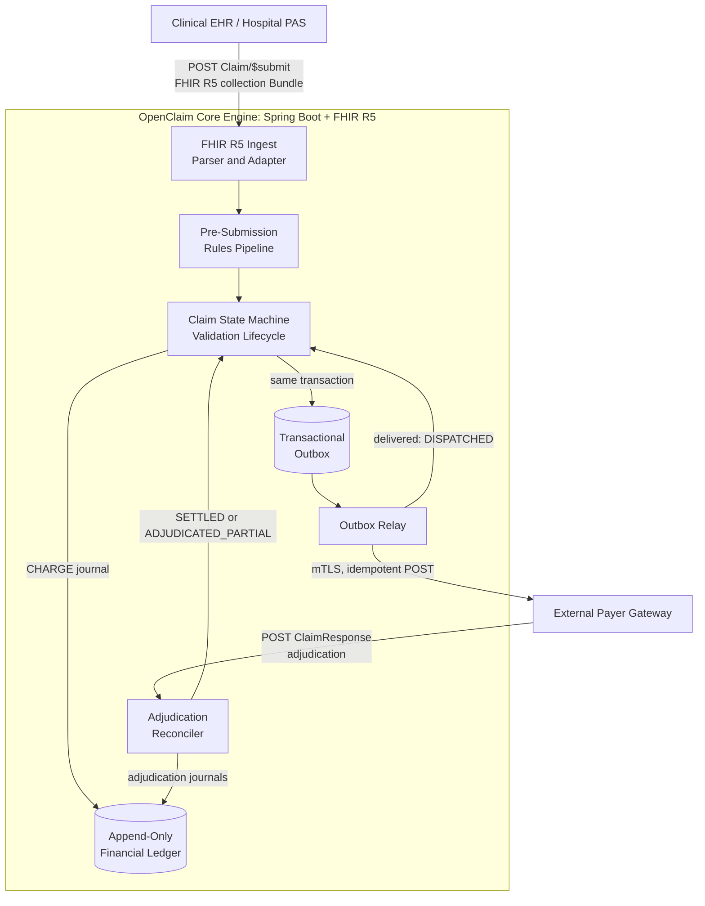

### Architectural Invariants

* **Zero Direct State Mutation on Balances:** All financial changes (charges, adjudication write-offs, payer payments, patient liability, patient payments) are recorded exclusively as append-only, balanced ledger journals. Balances are always computed from postings, never stored.
* **State-Driven Pipeline Guards:** Claims cannot bypass the rules engine. The lifecycle is an exhaustive `switch` checked by the compiler, and the only write path to the outbox refuses any claim that is not `PRE_VALIDATED`.
* **Deterministic Idempotency:** Re-transmissions across unreliable hospital or payer network interfaces cannot create duplicate entries or duplicate billing actions. Submissions, dispatches, remittances and patient payments are each keyed by a unique identifier enforced by the database.

---

## 2. HL7 FHIR R5 Domain Mapping

FHIR R5 introduces refined structures for encounters, coverage subscribers, and financial tracking compared to legacy R4 specifications.

| Clinical / Financial Concept | FHIR R5 Resource | Key R5 Element Paths & Refinements |
| --- | --- | --- |
| **Patient Demographics** | `Patient` | `identifier` (the MRN is the identifier whose `system` is configured). Name, birth date and gender are not consumed (data minimisation). |
| **Clinical Encounter** | `Encounter` | `actualPeriod` (replaces legacy `period`), `class` (now `CodeableConcept` **0..\***; the first v3-ActCode coding is the care setting), `subject` (`Reference<Patient>`, must be the claim's patient) |
| **Diagnostic Morbidity** | `Condition` | `code.coding` (synthetic diagnosis code system), `verificationStatus` (`refuted` / `entered-in-error` cannot support a claim), `subject` (must be the claim's patient) |
| **Insurance Coverage** | `Coverage` | `kind` (new in R5; only `insurance` is billable), `subscriberId` (now an array of `Identifier`; the policy number), `beneficiary` (must be the claim's patient), `insurer` (Reference; its identifier is the payer code) |
| **Medical Billing Claim** | `Claim` | `use` (must be `claim`), `status` (must be `active`), `identifier` (re-transmission key), `encounter` (Reference array; exactly one), `patient`, `insurance[].coverage` (the focal Coverage), `diagnosis[].diagnosis[x]` (`CodeableConcept` or `Reference(Condition)`), `item[].sequence` (unique), `item[].productOrService`, `item[].net`, `total` |
| **Payer Remittance** | `ClaimResponse` | `outcome` (must be `complete`), `request` (`Claim/<id>` or the claim identifier), `identifier` (re-transmission key), `total[].category` (HL7 `adjudication` codes `submitted`, `eligible`, `benefit`), `total[].amount`, `payment.amount` |

The payer's answer to a provider is a `ClaimResponse`. `ExplanationOfBenefit` is the member-facing summary and is not used.

Procedure and diagnosis codes use synthetic code systems (`https://openclaim.example.org/CodeSystem/*`) to avoid licensing CPT or SNOMED CT.

---

## 3. Claim Lifecycle & State Machine

A claim progresses through non-reversible states. State transitions are strictly enforced before ledger generation or network communication can occur.

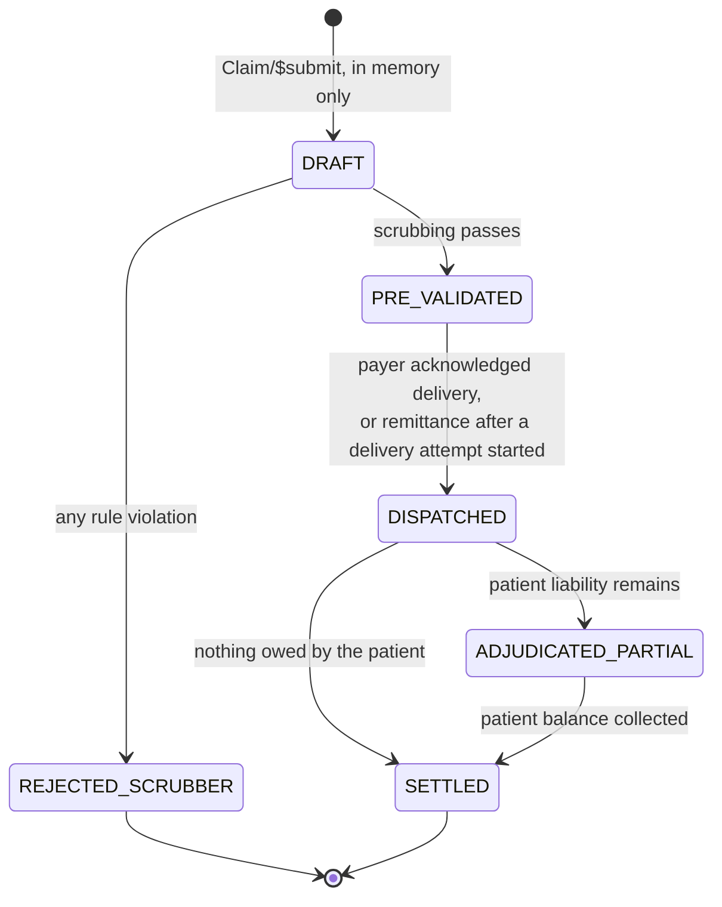

`DRAFT` exists only in memory during ingest; a claim is first stored in its scrubbed state. A contractual write-off alone does not make a claim partial: it is `SETTLED` when the patient owes nothing. A payer paying more than the eligible amount is rejected, not applied.

### Aggregate Model

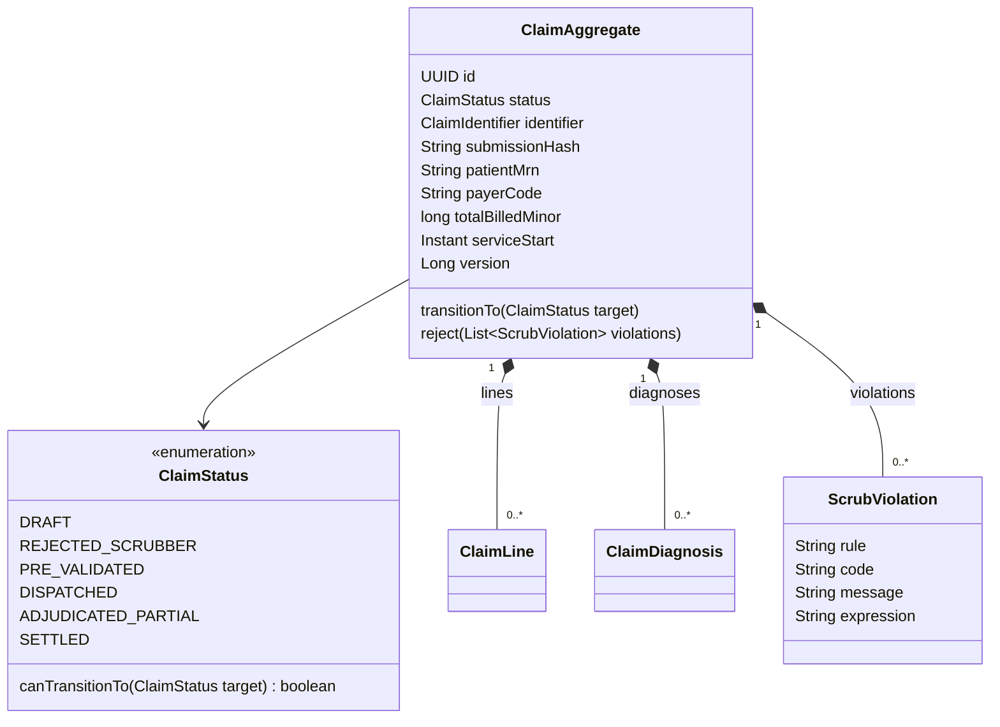

### State Transition Pseudocode

```
ENUM ClaimStatus:
    DRAFT, REJECTED_SCRUBBER, PRE_VALIDATED, DISPATCHED, ADJUDICATED_PARTIAL, SETTLED

CLASS ClaimAggregate:
    FIELD id: UUID
    FIELD status: ClaimStatus
    FIELD identifier: (system, value)       // unique; detects re-transmissions
    FIELD submissionHash: String            // content fingerprint of the mapped submission
    FIELD patientMrn: String?               // nullable: a missing MRN is a scrubber violation
    FIELD payerCode: String?
    FIELD totalBilledMinor: Long            // minor units of the configured currency
    FIELD serviceStart: Instant             // Encounter.actualPeriod.start; the ledger's valid time
    FIELD version: Long

    METHOD transitionTo(newStatus: ClaimStatus):
        IF NOT status.canTransitionTo(newStatus) THEN
            THROW InvalidStateTransitionException(this.status, newStatus)
        END IF
        this.status = newStatus

ENUM METHOD ClaimStatus.canTransitionTo(target) -> Boolean:   // exhaustive switch
    MATCH this:
        CASE DRAFT:               RETURN target IN [PRE_VALIDATED, REJECTED_SCRUBBER]
        CASE PRE_VALIDATED:       RETURN target == DISPATCHED
        CASE DISPATCHED:          RETURN target IN [SETTLED, ADJUDICATED_PARTIAL]
        CASE ADJUDICATED_PARTIAL: RETURN target == SETTLED
        CASE REJECTED_SCRUBBER, SETTLED: RETURN FALSE
```

---

## 4. Multi-Stage Rules Scrubbing Engine

Before external submission, claims pass through an ordered sequence of validation rules. **Every rule runs and every violation is collected**, so a submitter can correct a claim in one round trip. Any violation marks the claim `REJECTED_SCRUBBER` and each violation is stored with a code, a message and a FHIRPath expression for auditing.

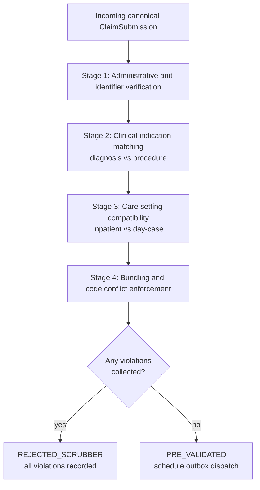

Every stage runs regardless of earlier failures; the decision is taken once, over the combined violations.

Rules never see FHIR resources. The FHIR adapter first maps the Bundle to a canonical `ClaimSubmission`:

* **Rejected before scrubbing (HTTP 422, nothing stored):** only problems that make the claim unidentifiable, unstorable or incoherent. For example, a missing `Claim.identifier`, an unresolvable reference, resources that belong to different patients, a refuted diagnosis, duplicate sequences, or money that is fractional, negative, in a foreign currency or inconsistent with `Claim.total`.
* **Mapped as absent:** missing business data (MRN, payer, policy number, encounter class) is mapped as `null` so the scrubber records it as a violation on a stored, rejected claim.

### Rule Model

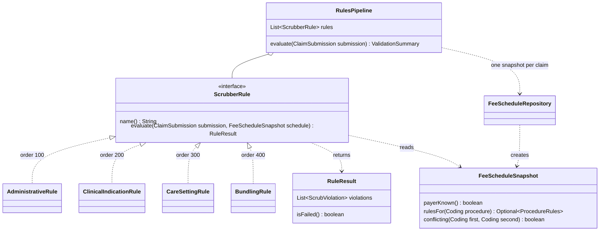

### Rules Engine Pseudocode

```
INTERFACE ScrubberRule:                       // Spring bean; order given by @Order
    METHOD evaluate(submission: ClaimSubmission, schedule: FeeScheduleSnapshot) -> RuleResult

RECORD RuleResult(violations: LIST OF ScrubViolation)   // empty = passed

CLASS AdministrativeRule IMPLEMENTS ScrubberRule:        // @Order(100)
    METHOD evaluate(submission, schedule) -> RuleResult:
        violations = EMPTY_LIST
        IF submission.patientMrn IS NULL THEN            // Patient.identifier with the MRN system
            violations.ADD("patient-identifier-missing")
        IF submission.payerCode IS NULL THEN violations.ADD("payer-missing")
        ELSE IF NOT schedule.payerKnown THEN violations.ADD("payer-unknown")
        policyNumber = submission.policyNumber           // focal Coverage.subscriberId
        IF policyNumber IS NULL THEN violations.ADD("policy-number-missing")
        ELSE IF NOT MATCHES(policyNumber, "^[A-Z0-9]{6,12}$") THEN violations.ADD("policy-number-format")
        IF submission.coverageKind IS PRESENT AND submission.coverageKind != "insurance" THEN
            violations.ADD("coverage-not-insurance")
        FOR EACH item IN submission.items:
            IF schedule.rulesFor(item.procedure) IS EMPTY THEN violations.ADD("procedure-unknown")
        RETURN RuleResult(violations)

CLASS ClinicalIndicationRule IMPLEMENTS ScrubberRule:    // @Order(200)
    METHOD evaluate(submission, schedule) -> RuleResult:
        violations = EMPTY_LIST
        FOR EACH item IN submission.items:
            allowed = schedule.rulesFor(item.procedure).allowedDiagnoses
            IF allowed IS PRESENT AND DISJOINT(allowed, submission.diagnoses) THEN
                violations.ADD("procedure-not-indicated", item)
        RETURN RuleResult(violations)

CLASS CareSettingRule IMPLEMENTS ScrubberRule:           // @Order(300)
    METHOD evaluate(submission, schedule) -> RuleResult:
        setting = submission.encounterClass     // first coding of Encounter.class[] (a list in R5)
        IF setting IS NULL OR setting.system != v3-ActCode THEN
            RETURN RuleResult(["encounter-class-missing"])
        violations = EMPTY_LIST
        FOR EACH item IN submission.items:
            allowed = schedule.rulesFor(item.procedure).allowedSettings   // e.g. AMB, IMP, SS
            IF allowed IS PRESENT AND setting.code NOT IN allowed THEN
                violations.ADD("care-setting-mismatch", item)
        RETURN RuleResult(violations)

CLASS BundlingRule IMPLEMENTS ScrubberRule:              // @Order(400)
    METHOD evaluate(submission, schedule) -> RuleResult:
        violations = EMPTY_LIST
        distinct = EMPTY_LIST
        FOR EACH item IN submission.items:
            IF item.procedure ALREADY SEEN THEN violations.ADD("duplicate-procedure", item)
            ELSE distinct.ADD(item)
        FOR EACH PAIR (first, second) IN distinct:
            IF schedule.conflicting(first.procedure, second.procedure) THEN
                violations.ADD("procedure-conflict", second)
        RETURN RuleResult(violations)

CLASS RulesPipeline:
    FIELD rules: LIST OF ScrubberRule            // injected already ordered
    FIELD feeSchedule: FeeScheduleRepository

    METHOD evaluate(submission) -> ValidationSummary:
        schedule = feeSchedule.snapshotFor(submission.procedures, submission.payerCode)
                                                          // one query per table, not per line
        violations = EMPTY_LIST
        FOR EACH rule IN rules:
            violations.ADD_ALL(rule.evaluate(submission, schedule).violations)
        RETURN ValidationSummary(violations)
```

Procedures are matched against the claim's diagnoses as a set; per-item `diagnosisSequence` linking is not evaluated.

---

## 5. Persistence, Outbox & Audit Ledger

### 5.1 Append-Only, Bi-Temporal, Double-Entry Ledger

Direct balance updates are forbidden. Every financial event is a **journal** of two or more **postings** that sum to zero, and every journal tracks two timelines:

1. **Transaction Time:** when the journal was recorded, stamped by the database clock (`now()`, the start of the recording transaction) regardless of what the application sends.
2. **Valid Time:** the real-world time the clinical care occurred (`Encounter.actualPeriod.start`).

```
RECORD LedgerJournal:
    id: UUID
    claimId: UUID
    entryType: LedgerEntryType   // CHARGE, PAYER_REMITTANCE, WRITE_OFF, PATIENT_LIABILITY, PATIENT_PAYMENT
    externalReference: String    // what makes the event unique per claim and type: the claim id (CHARGE),
                                 // the ClaimResponse identifier, or the payment Idempotency-Key
    transactionTime: Instant
    validTime: Instant

RECORD LedgerPosting:
    journalId: UUID
    account: LedgerAccount       // PAYER_AR, PATIENT_AR, REVENUE, CONTRACTUAL_ADJ, CASH
    amountMinor: Long            // non-zero; debit positive, credit negative
    currency: String

VIEW FinancialLedgerEntry = LedgerJournal JOIN LedgerPosting   // one row per posting
```

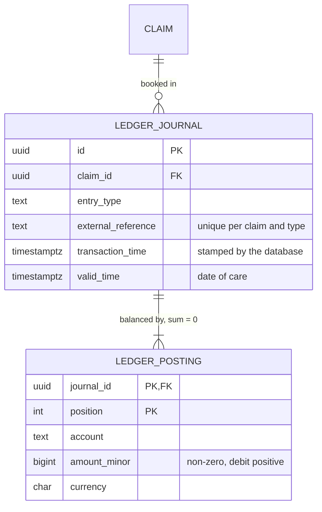

How money moves between accounts (each arrow is one journal, from the credited account to the debited one):

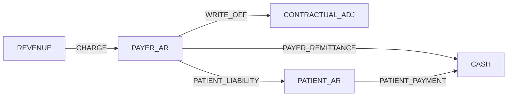

| Journal | Debit | Credit | When |
| --- | --- | --- | --- |
| `CHARGE` | PAYER_AR | REVENUE | Claim accepted (`PRE_VALIDATED`) |
| `WRITE_OFF` | CONTRACTUAL_ADJ | PAYER_AR | Remittance: billed − eligible |
| `PAYER_REMITTANCE` | CASH | PAYER_AR | Remittance: benefit paid |
| `PATIENT_LIABILITY` | PATIENT_AR | PAYER_AR | Remittance: eligible − benefit |
| `PATIENT_PAYMENT` | CASH | PATIENT_AR | Patient pays, up to the patient balance |

Double entry is required because patient liability is a reclassification between two receivables; a single-entry ledger cannot record it without double counting. The database enforces the invariants: triggers reject `UPDATE`, `DELETE` and `TRUNCATE`, and a deferred constraint trigger requires each journal to balance, in one currency, at commit.

### 5.2 Transactional Outbox & Deterministic Idempotency

To eliminate dual-write hazards between database updates and external HTTP dispatches, the claim, its charge and the outbox event are persisted inside a single local database transaction. Nothing is sent to the payer during ingest.

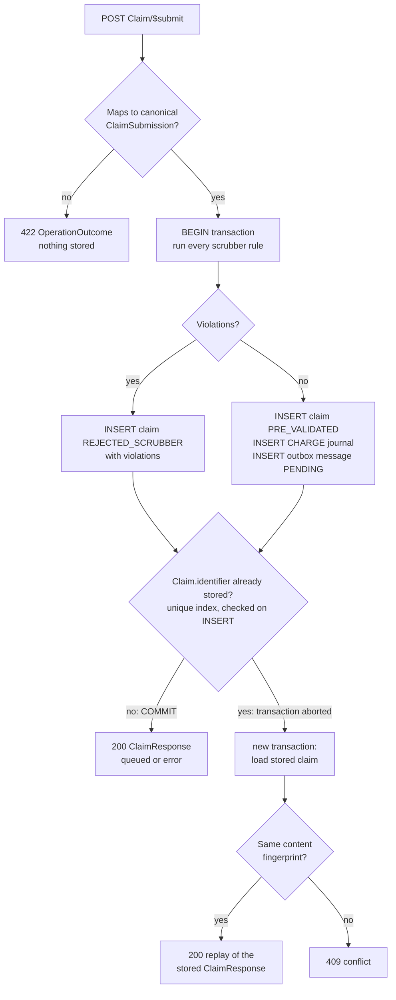

```
ALGORITHM TransactionalClaimIngest:
    INPUT: FHIR_R5_Bundle

    submission = MapToCanonical(FHIR_R5_Bundle)          // 422 on structural problems; nothing stored

    TRY:
        BEGIN TRANSACTION
            claim = ClaimAggregate.draft(submission)     // DRAFT, in memory only
            summary = RulesPipeline.evaluate(submission)

            IF summary.hasViolations() THEN
                claim.transitionTo(REJECTED_SCRUBBER)
                claim.violations = summary.violations
                Persist(claim)
                COMMIT TRANSACTION
                RETURN ClaimResponse(outcome = "error", one error per violation)
            END IF

            claim.transitionTo(PRE_VALIDATED)
            Persist(claim)                               // UNIQUE (identifier.system, identifier.value)
            AppendJournal(CHARGE, claim.totalBilledMinor, validTime = claim.serviceStart)

            // Versioned, length-prefixed fields: plain concatenation is ambiguous ("ab"+"c" = "a"+"bc"),
            // and the identifier system distinguishes EHRs that issue the same identifier value.
            idempotencyKey = SHA256(LengthPrefixed(
                "dispatch-v1", claim.payerCode, claim.patientMrn,
                claim.identifier.system, claim.identifier.value, claim.totalBilledMinor))

            Outbox.enqueueDispatch(claim,                // refuses any claim not PRE_VALIDATED
                eventType = "CLAIM_PRE_VALIDATED",
                payload = FHIR collection Bundle rendered now, Claim.id = claim.id,
                idempotencyKey = idempotencyKey,
                status = "PENDING")
        COMMIT TRANSACTION
        RETURN ClaimResponse(outcome = "queued")

    CATCH UniqueViolation ON claim.identifier:
        // The database aborted that transaction; look up the stored claim in a new one.
        existing = FindByIdentifier(submission.identifier)
        IF existing.submissionHash == Fingerprint(submission) THEN
            RETURN stored response for existing           // replay
        ELSE
            RETURN 409 Conflict                           // same identifier, different content
```

**Outbox relay.** A poller reserves due messages with `FOR UPDATE SKIP LOCKED`, marking them `IN_FLIGHT` with a lease expiry and a fresh lease token, and commits before any network call. It POSTs each payload with an `Idempotency-Key` header over mutual TLS. The outcome is then recorded with an update fenced by the lease token, so a relay whose lease expired cannot overwrite a newer attempt. On success, the claim moves to `DISPATCHED` in the same transaction.

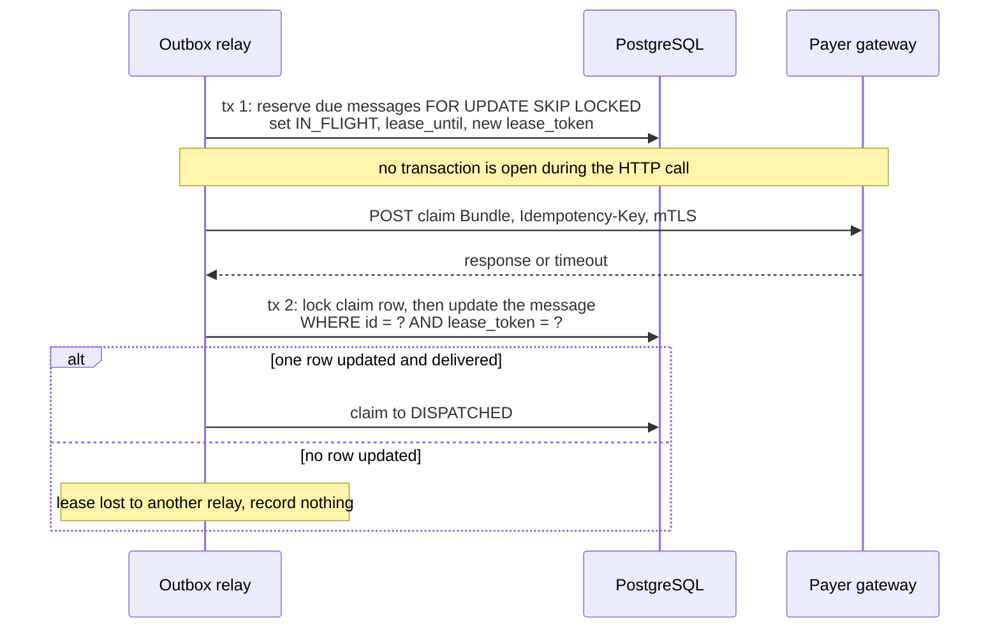

| Payer response | Result |
| --- | --- |
| 2xx, or 409 (already received with this key) | Delivered |
| Other 4xx | Failed; needs a person |
| 5xx, 429, network error | Retried with exponential backoff and jitter, honouring a capped `Retry-After` |
| Attempts exhausted | Failed |

Throughput is limited by batch size per poll interval.

---

## 6. End-to-End Execution Sequence

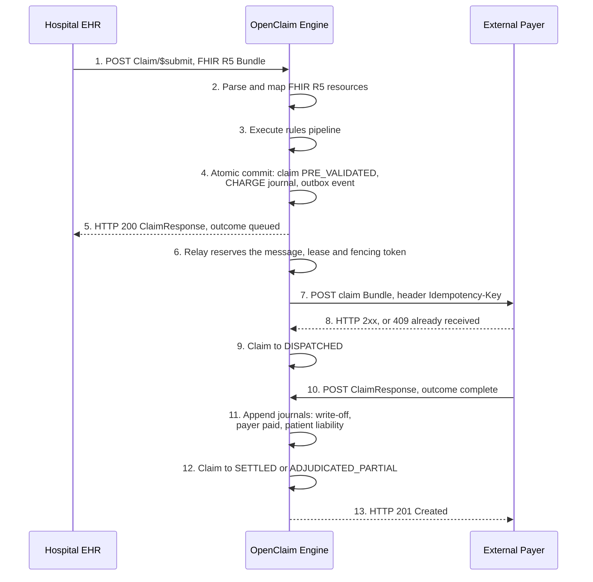

A rejected claim gets `HTTP 200` with `outcome = error` and one `error` entry per violation in step 5, and is never dispatched.

If the remittance (step 10) arrives before the relay has recorded delivery (step 9), it counts as proof of delivery, but only once a delivery attempt has started. Otherwise the payer cannot have the claim and the remittance is refused with 409.

A payer may adjudicate only its own claims; another payer's claim is answered exactly like an unknown claim, so claim existence cannot be probed.

---

## 7. High-Level Modular Project Blueprint

Package-by-feature, separating FHIR infrastructure from core revenue business rules:

```
com.openclaim.engine
├── config        // Typed openclaim.* properties, security (JWT scopes), clock
├── fhir          // The only package that knows FHIR
│   ├── FhirConfiguration              // Shared FhirContext (R5)
│   ├── FhirResourceHttpMessageConverter // Strict parsing, size limit, media types
│   ├── BundleIndex                    // Reference resolution within a Bundle
│   ├── ClaimSubmissionMapper          // Bundle -> canonical ClaimSubmission
│   ├── RemittanceMapper               // ClaimResponse -> Adjudication
│   └── ClaimResponseFactory           // Canonical outcome -> ClaimResponse
├── claim         // ClaimAggregate, ClaimStatus, ClaimSubmission, fingerprints, repository
├── rules         // ScrubberRule, RuleResult, RulesPipeline, fee schedule
│   └── validators // Administrative, ClinicalIndication, CareSetting, Bundling
├── ledger        // Balanced journals, postings, balances, FinancialLedgerEntry view
├── ingest        // ClaimIngestionService: the $submit transaction
├── outbox        // Outbox storage, relay (leases, fencing, backoff), payer client (mTLS)
├── remittance    // AdjudicationReconciler, PatientPaymentService
└── web           // Controllers, OperationOutcome and problem-detail error mapping
```

Package dependencies as built (arrows point from user to dependency; there are no cycles):

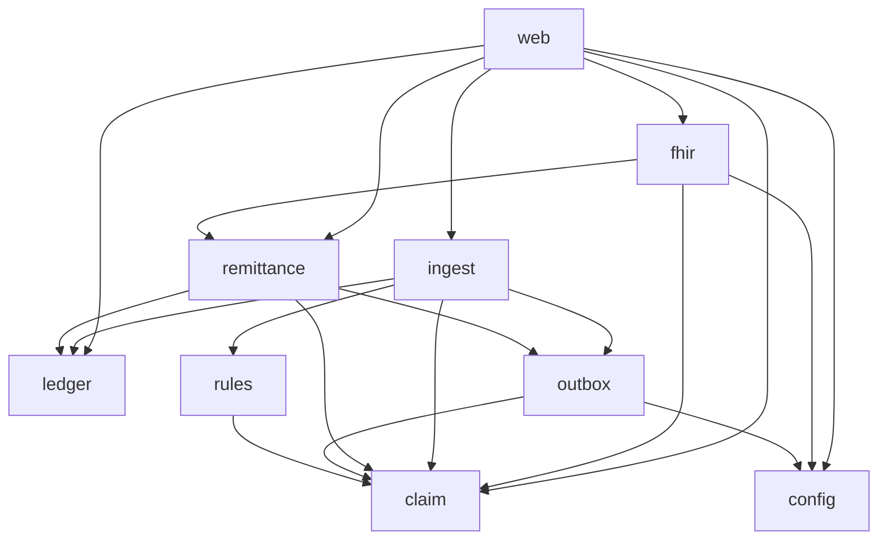

Spring Data repositories serve as the storage ports; no separate port interfaces are declared. ArchUnit enforces the boundaries: no package cycles, HAPI only in `fhir` and `web`, no web types in the domain, rules never touch the database, and postings are built only inside `ledger`.

---

## 8. Portfolio Showcase Strategy

To demonstrate senior engineering capabilities on GitHub, structure the project documentation and tests around these engineering highlights:

1. **Modern FHIR R5 Standard Adoption:** Explicitly document the migration from R4 to R5, showing understanding of evolving healthcare data protocols (e.g., changes to `Encounter.actualPeriod`, `Encounter.class`, `Coverage.subscriberId`, `Coverage.kind`, and choice-typed diagnosis references).
2. **Deterministic Domain Rules:** Showcase how business validation is separated into composable, isolated, ordered rules rather than monolithic conditionals.
3. **Resilience via Transactional Outbox:** Explain how saving the claim state and the outbound message atomically solves the dual-write problem, and how leases with fencing tokens make delivery safe across relay crashes.
4. **Auditability via Append-Only Accounting:** Highlight that financial data is modeled bi-temporally with immutable, balanced double-entry journals whose invariants the database itself enforces.
